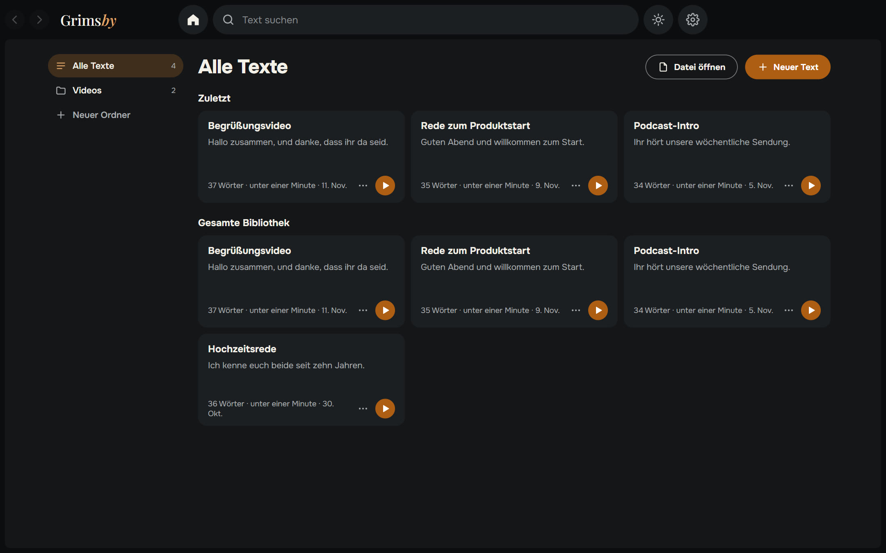
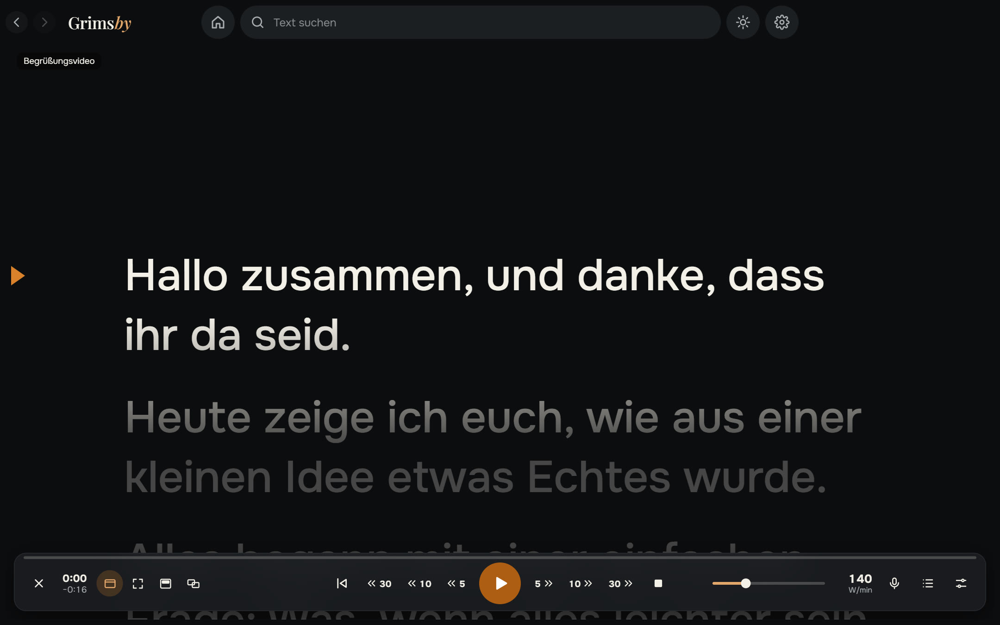
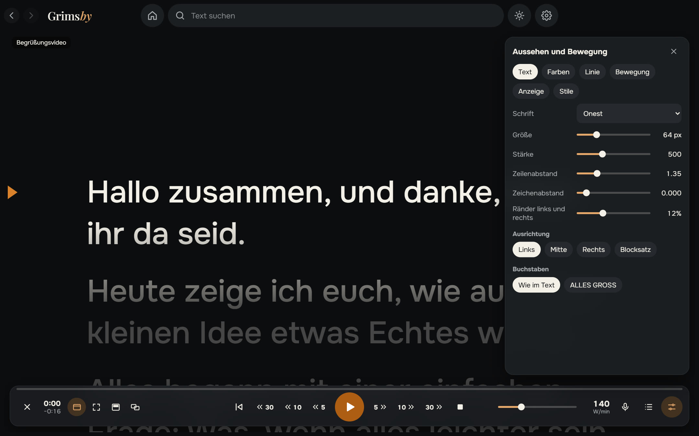
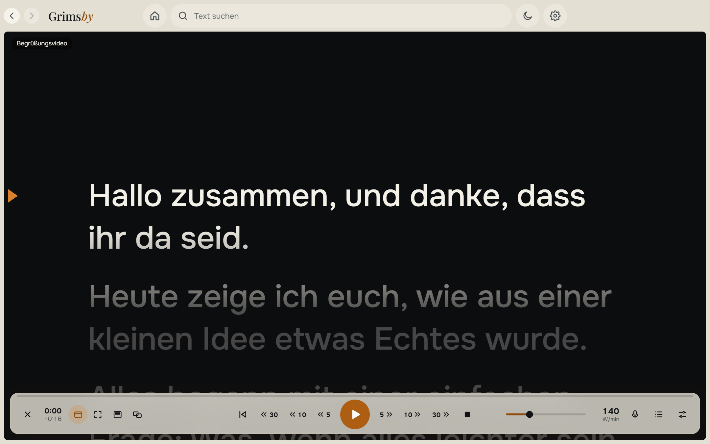

  <a href="README.md">English</a> ·
  <a href="README.ru.md">Русский</a> ·
  <a href="README.es.md">Español</a> ·
  <a href="README.pt.md">Português</a> ·
  <b>Deutsch</b> ·
  <a href="README.fr.md">Français</a> ·
  <a href="README.zh.md">中文</a> ·
  <a href="README.ja.md">日本語</a> ·
  <a href="README.ko.md">한국어</a>

  

  <b>Ein einfacher Teleprompter für Windows, der deiner Stimme folgt.</b> 
  Text einfügen, Start drücken und lesen: sanfter Textlauf, Stimmverfolgung ohne Internet, über anderen Fenstern oder auf einem zweiten Monitor.

  
  
  
  
  

  <a href="https://github.com/maksimkhatskevich/grimsby-prompter/releases/latest"><b>⬇ Für Windows herunterladen</b></a>
  &nbsp;·&nbsp;
  <a href="#funktionen">Funktionen</a>
  &nbsp;·&nbsp;
  <a href="#datenschutz">Datenschutz</a>
  &nbsp;·&nbsp;
  <a href="#feedback">Feedback</a>

---

## Warum Grimsby Prompter

Vom Bildschirm abzulesen wirkt nur natürlich, wenn der Text mit dir Schritt hält. Viele Teleprompter laufen stur mit einer Geschwindigkeit oder verstecken die nützlichen Einstellungen in endlosen Menüs.

**Grimsby Prompter bleibt einfach.** Das Wichtigste ist sofort sichtbar, die Feinheiten sind verstaut. Start drücken und lesen: Der Text läuft in deinem Tempo oder folgt deiner Stimme.

---

## Funktionen

### 📚 Alle Texte an einem Ort

Eine Bibliothek mit Ordnern und Suche. Text einfügen oder txt, md, rtf, docx und pdf öffnen – oder einfach eine Datei ins Fenster ziehen. Alles wird automatisch gespeichert, und jeder Text merkt sich, wo du aufgehört hast.

### 🎬 Sanftes Lesen

Weiches Anfahren und Bremsen, ein Tempo, das sich beim Lesen ändern lässt, und eine Leselinie, die den Text darüber und darunter abdunkelt. Fortlaufend oder zeilen-, absatz- und seitenweise. 5, 10 oder 30 Sekunden zurück- oder vorspringen – genau über das bereits Gelesene, auch wenn sich das Tempo geändert hat. **In vorgegebene Zeit passen** berechnet das Tempo für dich.

### 🎙 Folgt deiner Stimme

Du sprichst – der Text läuft; du schweigst – er wartet; du lässt einen Satz aus oder improvisierst – er findet die richtige Stelle. Die Erkennung läuft auf deinem Computer in 9 Sprachen: Ein Sprachmodell wird einmal geladen, nur mit deiner Zustimmung, und funktioniert danach ohne Internet. Das Mikrofon ist nur in diesem Modus an, und der Ton wird nie gespeichert oder irgendwohin gesendet.

### 🖥 Der Text, wo du ihn brauchst

Im Fenster oder im Vollbild; als halbtransparenter Streifen über allen Programmen, den du direkt unter die Webcam legen kannst; im Vollbild auf einem zweiten Monitor mit der Steuerung auf dem Hauptbildschirm; horizontal oder vertikal gespiegelt für Teleprompter-Glas.

### 🎨 Aussehen und Bewegung

Schrift, Größe, Stärke, Zeilen- und Zeichenabstand, Ränder, Ausrichtung und GROSSBUCHSTABEN. Text- und Hintergrundfarbe oder ein Verlauf. Fertige und eigene Stile. Tastenkürzel lassen sich ändern, und globale Kürzel funktionieren auch, wenn ein anderes Programm aktiv ist.

🌍 **9 Sprachen:** Englisch, Russisch, Spanisch, Portugiesisch, Deutsch, Französisch, Chinesisch, Japanisch und Koreanisch – umschalten in den Einstellungen, sofort wirksam.

Das helle Design ist einen Klick entfernt – der Sonnenknopf oben.

---

## Herunterladen und installieren

1. Öffne die Seite der **[neuesten Version](https://github.com/maksimkhatskevich/grimsby-prompter/releases/latest)** und lade das Installationsprogramm `.exe` herunter.
2. Starte es. Windows zeigt eventuell ein blaues Fenster „Der Computer wurde durch Windows geschützt“ – eine normale Warnung für Programme ohne kostenpflichtiges Signaturzertifikat. Klicke auf **Weitere Informationen → Trotzdem ausführen**.
   Das Installationsprogramm wurde bei VirusTotal geprüft: [keiner der 67 Virenscanner schlägt an](https://www.virustotal.com/gui/file/21cec8155312cbb75dcf7c4b22757e0e21429176e19869b34bfa85b5cb0c2b19) (Version 1.0.0).
3. Klicke auf **Neuer Text** oder zieh eine Datei ins Fenster.

**Voraussetzungen:** Windows 10 oder 11 (64 Bit). Ein Mikrofon brauchst du nur für die Stimmverfolgung. Internet brauchst du nur, um ein Sprachmodell zu laden und nach Updates zu suchen.

---

## Datenschutz

Grimsby Prompter arbeitet auf deinem Computer. Deine Texte werden nur dort gespeichert, und der Ton vom Mikrofon wird nie gespeichert oder gesendet. Ohne Konto, ohne Werbung, ohne Analyse. Online geht das Programm nur, um das von dir gewählte Sprachmodell zu laden und nach Updates zu suchen.

---

## Grimsby-Apps

<table>
  <tr>
    <td align="center" width="20%"><a href="https://github.com/maksimkhatskevich/grimsby-releases/blob/main/README.de.md"> <b>Grimsby Player</b></a> Offline-Player für deine heruntergeladene Musik und Videos</td>
    <td align="center" width="20%"><a href="https://github.com/maksimkhatskevich/grimsby-converter/blob/main/README.de.md"> <b>Grimsby Converter</b></a> Videos, Audio, Fotos und Dokumente – offline umwandeln</td>
    <td align="center" width="20%"><a href="https://github.com/maksimkhatskevich/grimsby-tagger/blob/main/README.de.md"> <b>Grimsby Tagger</b></a> Tag-Editor für ganze Alben: Tags, Cover, Dateinamen</td>
    <td align="center" width="20%"> <b>Grimsby Prompter</b> </td>
    <td align="center" width="20%"><a href="https://github.com/maksimkhatskevich/grimsby-helper/blob/main/README.de.md"> <b>Grimsby Helper</b></a> PC-Zustand auf einen Blick: Prozesse, Temperaturen, Bereinigung</td>
  </tr>
</table>

---

## Feedback

Einen Fehler gefunden, eine Idee oder einfach Danke sagen? Schreib mir:

- ✉️ E-Mail: **[grimsbyy@gmail.com](mailto:grimsbyy@gmail.com)**
- 🐞 Fehler und Ideen: [Issues](https://github.com/maksimkhatskevich/grimsby-prompter/issues)
- 📣 Telegram: [@itsgrimsby](https://t.me/itsgrimsby) (auf Russisch)

---

## Lizenzen

Grimsby Prompter nutzt Open-Source-Komponenten, darunter Electron, React und eine Offline-Spracherkennung mit ihren Sprachmodellen. Die vollständige Liste mit Lizenztexten steht in `THIRD_PARTY_NOTICES.txt` im Programmordner.

© 2026 Grimsby

