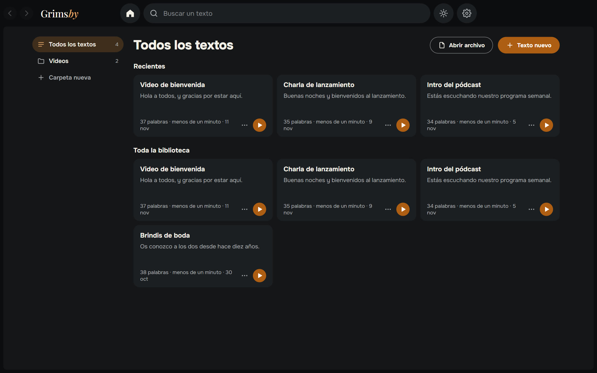
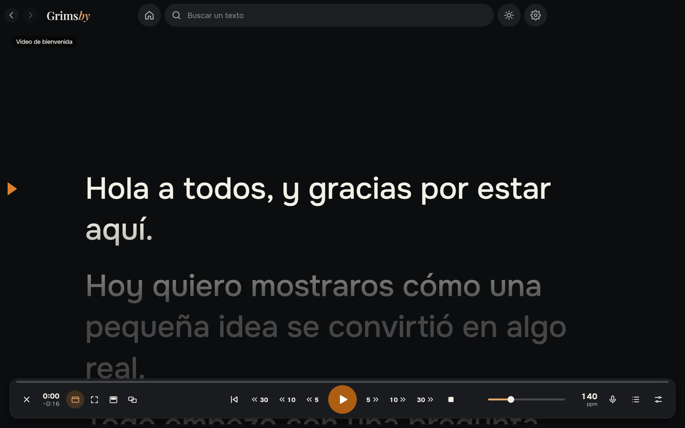
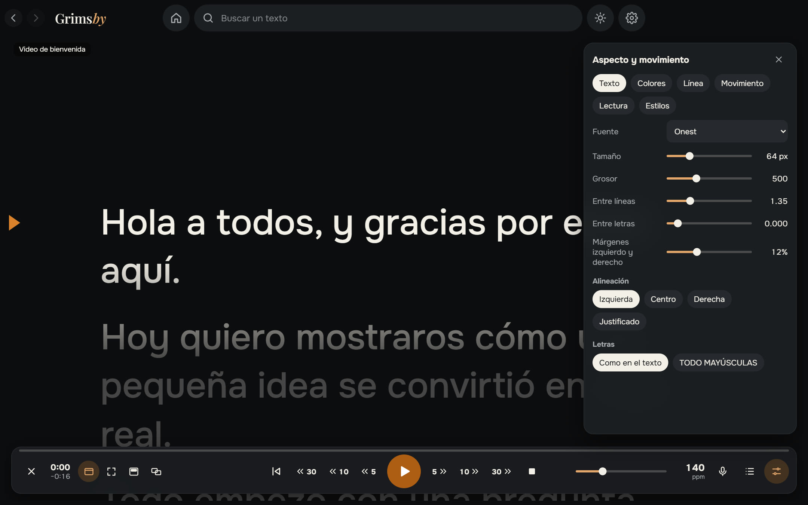
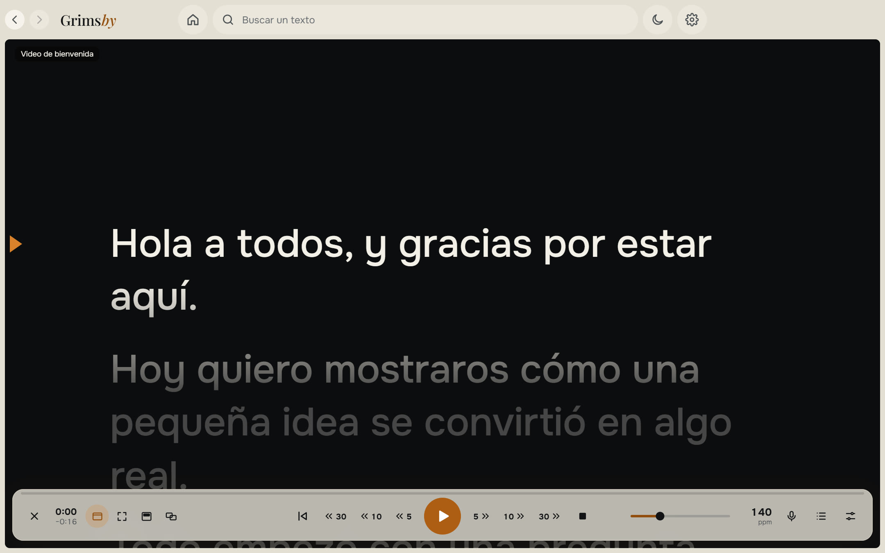

  <a href="README.md">English</a> ·
  <a href="README.ru.md">Русский</a> ·
  <b>Español</b> ·
  <a href="README.pt.md">Português</a> ·
  <a href="README.de.md">Deutsch</a> ·
  <a href="README.fr.md">Français</a> ·
  <a href="README.zh.md">中文</a> ·
  <a href="README.ja.md">日本語</a> ·
  <a href="README.ko.md">한국어</a>

  

  <b>Un teleprompter sencillo para Windows que sigue tu voz.</b> 
  Pega tu texto, pulsa iniciar y lee: desplazamiento suave, seguimiento de voz sin conexión, sobre otras ventanas o en un segundo monitor.

  
  
  
  
  

  <a href="https://github.com/maksimkhatskevich/grimsby-prompter/releases/latest"><b>⬇ Descargar para Windows</b></a>
  &nbsp;·&nbsp;
  <a href="#funciones">Funciones</a>
  &nbsp;·&nbsp;
  <a href="#privacidad">Privacidad</a>
  &nbsp;·&nbsp;
  <a href="#contacto">Contacto</a>

---

## Por qué Grimsby Prompter

Leer desde una pantalla solo parece natural cuando el texto va a tu ritmo. Muchos teleprompters se desplazan a una velocidad fija o esconden los ajustes útiles en menús interminables.

**Grimsby Prompter es sencillo.** Lo esencial está a la vista y los ajustes finos, guardados. Pulsa iniciar y lee: el texto avanza a tu ritmo o sigue tu voz.

---

## Funciones

### 📚 Todos tus textos en un sitio

Una biblioteca con carpetas y búsqueda. Pega un texto o abre txt, md, rtf, docx y pdf, o simplemente arrastra un archivo a la ventana. Todo se guarda solo, y cada texto recuerda dónde dejaste de leer.

### 🎬 Lectura suave

Arranque y frenado suaves, velocidad que cambias mientras lees y una línea de lectura que atenúa el texto de arriba y de abajo. Desplazamiento continuo o modos por línea, párrafo y página. Retrocede o avanza 5, 10 o 30 segundos, justo sobre lo que ya leíste, aunque la velocidad haya cambiado. **Ajustar a un tiempo** calcula la velocidad por ti.

### 🎙 Sigue tu voz

Hablas y el texto avanza; te callas y espera; te saltas una frase o improvisas y encuentra el lugar correcto. El reconocimiento funciona en tu ordenador en 9 idiomas: el modelo de idioma se descarga una vez, solo si aceptas, y después funciona sin internet. El micrófono solo se activa en este modo, y el sonido nunca se guarda ni se envía a ningún sitio.

### 🖥 El texto donde lo necesitas

En una ventana o a pantalla completa; una franja semitransparente sobre todas las aplicaciones que puedes colocar justo bajo la webcam; a pantalla completa en un segundo monitor con los controles en el principal; en espejo horizontal o vertical para el cristal del teleprompter.

### 🎨 Aspecto y movimiento

Fuente, tamaño, grosor, interlineado y espaciado entre letras, márgenes, alineación y TODO EN MAYÚSCULAS. Colores de texto y fondo o un degradado. Estilos listos y los tuyos. Los atajos se pueden cambiar, y los atajos globales funcionan aunque otra aplicación esté activa.

🌍 **9 idiomas:** inglés, ruso, español, portugués, alemán, francés, chino, japonés y coreano; se cambian en Ajustes al instante.

El tema claro está a un clic: el botón del sol, arriba.

---

## Descargar e instalar

1. Abre la página de la **[última versión](https://github.com/maksimkhatskevich/grimsby-prompter/releases/latest)** y descarga el instalador `.exe`.
2. Ejecútalo. Windows puede mostrar una ventana azul «Windows protegió su PC»: es un aviso normal para programas sin certificado de firma de pago. Pulsa **Más información → Ejecutar de todas formas**.
   El instalador se ha analizado en VirusTotal: [ninguno de 67 antivirus detecta nada](https://www.virustotal.com/gui/file/21cec8155312cbb75dcf7c4b22757e0e21429176e19869b34bfa85b5cb0c2b19) (versión 1.0.0).
3. Pulsa **Texto nuevo** o arrastra un archivo a la ventana.

**Requisitos:** Windows 10 u 11 (64 bits). El micrófono solo hace falta para seguir la voz. Internet solo hace falta para descargar un modelo de voz y buscar actualizaciones.

---

## Privacidad

Grimsby Prompter funciona en tu ordenador. Tus textos se guardan solo ahí, y el sonido del micrófono nunca se guarda ni se envía a ningún sitio. Sin cuentas, sin anuncios, sin analíticas. La aplicación solo se conecta para descargar el modelo de voz que elijas y para buscar actualizaciones.

---

## Las apps de Grimsby

<table>
  <tr>
    <td align="center" width="20%"><a href="https://github.com/maksimkhatskevich/grimsby-releases/blob/main/README.es.md"> <b>Grimsby Player</b></a> Reproductor sin conexión para tu música y videos descargados</td>
    <td align="center" width="20%"><a href="https://github.com/maksimkhatskevich/grimsby-converter/blob/main/README.es.md"> <b>Grimsby Converter</b></a> Video, audio, fotos y documentos, convertidos sin conexión</td>
    <td align="center" width="20%"><a href="https://github.com/maksimkhatskevich/grimsby-tagger/blob/main/README.es.md"> <b>Grimsby Tagger</b></a> Editor de etiquetas por lotes: álbumes, portadas, nombres de archivo</td>
    <td align="center" width="20%"> <b>Grimsby Prompter</b> </td>
    <td align="center" width="20%"><a href="https://github.com/maksimkhatskevich/grimsby-helper/blob/main/README.es.md"> <b>Grimsby Helper</b></a> El estado de tu PC de un vistazo: procesos, temperaturas, limpieza</td>
  </tr>
</table>

---

## Contacto

¿Encontraste un error, tienes una idea o solo quieres dar las gracias? Escríbeme:

- ✉️ correo: **[grimsbyy@gmail.com](mailto:grimsbyy@gmail.com)**
- 🐞 errores e ideas: [Issues](https://github.com/maksimkhatskevich/grimsby-prompter/issues)
- 📣 Telegram: [@itsgrimsby](https://t.me/itsgrimsby) (en ruso)

---

## Licencias

Grimsby Prompter usa componentes de código abierto, entre ellos Electron, React y un motor de reconocimiento de voz sin conexión con sus modelos de idioma. La lista completa con los textos de las licencias está en `THIRD_PARTY_NOTICES.txt`, en la carpeta del programa.

© 2026 Grimsby

