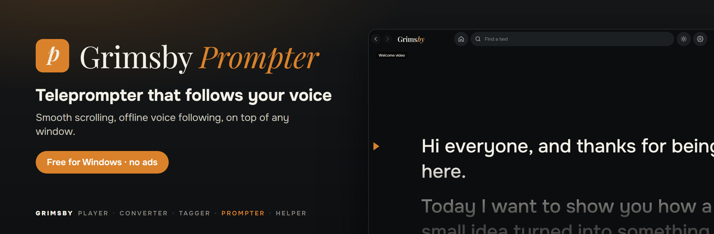
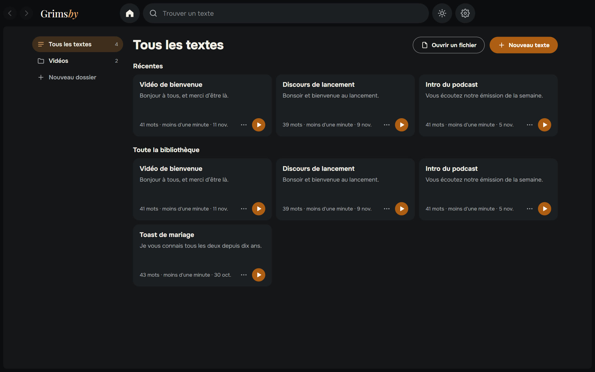
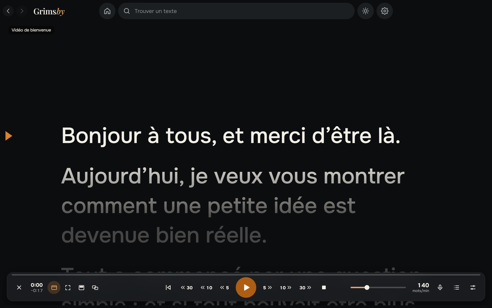
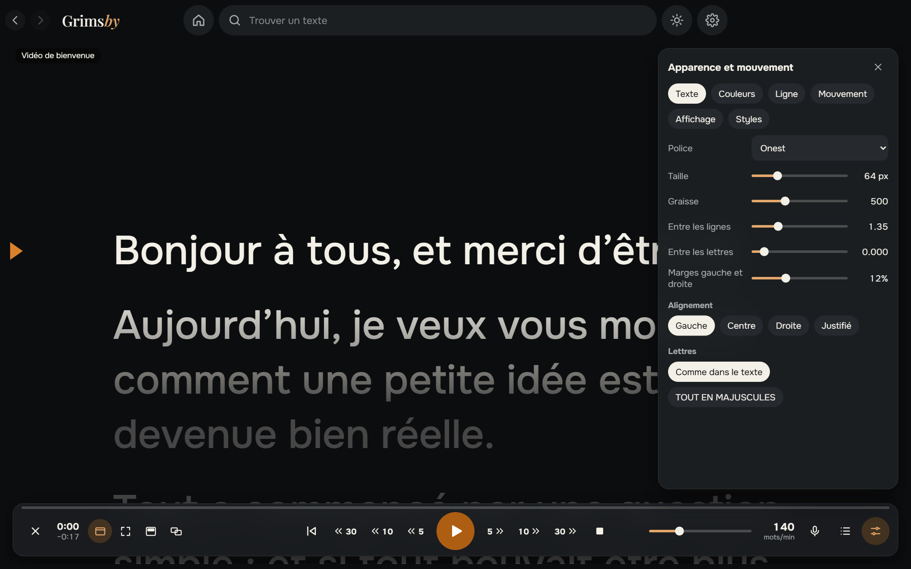
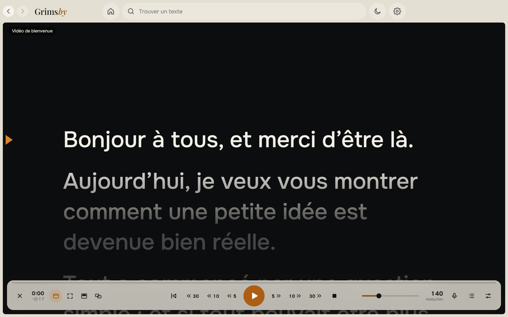

  <a href="README.md">English</a> ·
  <a href="README.ru.md">Русский</a> ·
  <a href="README.es.md">Español</a> ·
  <a href="README.pt.md">Português</a> ·
  <a href="README.de.md">Deutsch</a> ·
  <b>Français</b> ·
  <a href="README.zh.md">中文</a> ·
  <a href="README.ja.md">日本語</a> ·
  <a href="README.ko.md">한국어</a>

  

  <b>Un téléprompteur simple pour Windows qui suit votre voix.</b> 
  Collez votre texte, lancez et lisez : défilement fluide, suivi de la voix hors ligne, au-dessus des autres fenêtres ou sur un second écran.

  
  
  
  

  <a href="https://github.com/maksimkhatskevich/grimsby-prompter/releases/latest"><b>⬇ Télécharger pour Windows</b></a>
  &nbsp;·&nbsp;
  <a href="#fonctionnalités">Fonctionnalités</a>
  &nbsp;·&nbsp;
  <a href="#confidentialité">Confidentialité</a>
  &nbsp;·&nbsp;
  <a href="#contact">Contact</a>

---

## Pourquoi Grimsby Prompter

Lire sur un écran n’a l’air naturel que si le texte suit votre rythme. Beaucoup de téléprompteurs défilent à vitesse fixe ou cachent les réglages utiles dans des menus sans fin.

**Grimsby Prompter reste simple.** L’essentiel est visible tout de suite, les réglages fins sont rangés. Lancez et lisez : le texte avance à votre rythme ou suit votre voix.

---

## Fonctionnalités

### 📚 Tous vos textes au même endroit

Une bibliothèque avec dossiers et recherche. Collez un texte ou ouvrez des fichiers txt, md, rtf, docx et pdf — ou déposez simplement un fichier dans la fenêtre. Tout est enregistré automatiquement, et chaque texte se souvient de l’endroit où vous vous êtes arrêté.

### 🎬 Une lecture fluide

Démarrage et arrêt en douceur, vitesse réglable pendant la lecture et une ligne de lecture qui assombrit le texte au-dessus et en dessous. Défilement continu ou modes par ligne, paragraphe et page. Revenez ou avancez de 5, 10 ou 30 secondes — exactement sur ce que vous avez déjà lu, même si la vitesse a changé. **Tenir dans un temps donné** calcule la vitesse pour vous.

### 🎙 Il suit votre voix

Vous parlez, le texte avance ; vous vous taisez, il attend ; vous sautez une phrase ou improvisez, il retrouve le bon endroit. La reconnaissance fonctionne sur votre ordinateur en 9 langues : le modèle de langue est téléchargé une seule fois, uniquement avec votre accord, puis fonctionne sans internet. Le micro n’est activé que dans ce mode, et le son n’est jamais enregistré ni envoyé.

### 🖥 Le texte là où il vous faut

Dans une fenêtre ou en plein écran ; une bande semi-transparente au-dessus de toutes les applications, à placer juste sous la webcam ; en plein écran sur un second écran avec les commandes sur l’écran principal ; en miroir horizontal ou vertical pour la vitre du téléprompteur.

### 🎨 Apparence et mouvement

Police, taille, graisse, interligne et espacement des lettres, marges, alignement et TOUT EN MAJUSCULES. Couleurs du texte et du fond ou un dégradé. Styles prêts à l’emploi et les vôtres. Les raccourcis se modifient, et les raccourcis globaux fonctionnent même quand une autre application est active.

🌍 **9 langues :** anglais, russe, espagnol, portugais, allemand, français, chinois, japonais et coréen — à changer dans les Réglages, effet immédiat.

Le thème clair est à un clic — le bouton soleil en haut.

---

## Télécharger et installer

1. Ouvrez la page de la **[dernière version](https://github.com/maksimkhatskevich/grimsby-prompter/releases/latest)** et téléchargez l’installeur `.exe`.
2. Lancez-le. Windows peut afficher une fenêtre bleue « Windows a protégé votre ordinateur » : c’est un avertissement normal pour les logiciels sans certificat de signature payant. Cliquez sur **Informations complémentaires → Exécuter quand même**.
3. Cliquez sur **Nouveau texte** ou déposez un fichier dans la fenêtre.

**Configuration requise :** Windows 10 ou 11 (64 bits). Un micro n’est nécessaire que pour le suivi de la voix. Internet n’est nécessaire que pour télécharger un modèle de voix et vérifier les mises à jour.

---

## Confidentialité

Grimsby Prompter fonctionne sur votre ordinateur. Vos textes ne sont enregistrés que là, et le son du micro n’est jamais enregistré ni envoyé. Sans compte, sans publicité, sans statistiques. L’application ne se connecte que pour télécharger le modèle de voix choisi et vérifier les mises à jour.

---

## Les applis Grimsby

<table>
  <tr>
    <td align="center" width="20%"><a href="https://github.com/maksimkhatskevich/grimsby-releases/blob/main/README.fr.md"> <b>Grimsby Player</b></a> Lecteur hors ligne pour votre musique et vos clips téléchargés</td>
    <td align="center" width="20%"><a href="https://github.com/maksimkhatskevich/grimsby-converter/blob/main/README.fr.md"> <b>Grimsby Converter</b></a> Vidéo, audio, photos et documents convertis hors ligne</td>
    <td align="center" width="20%"><a href="https://github.com/maksimkhatskevich/grimsby-tagger/blob/main/README.fr.md"> <b>Grimsby Tagger</b></a> Éditeur de tags par lots : albums, pochettes, noms de fichiers</td>
    <td align="center" width="20%"> <b>Grimsby Prompter</b> </td>
    <td align="center" width="20%"><a href="https://github.com/maksimkhatskevich/grimsby-helper/blob/main/README.fr.md"> <b>Grimsby Helper</b></a> L’état de votre PC en un coup d’œil : processus, températures, nettoyage</td>
  </tr>
</table>

---

## Contact

Un bug, une idée ou juste envie de dire merci ? Écrivez-moi :

- ✉️ e-mail: **[grimsbyy@gmail.com](mailto:grimsbyy@gmail.com)**
- 🐞 bugs et idées: [Issues](https://github.com/maksimkhatskevich/grimsby-prompter/issues)
- 📣 Telegram : [@itsgrimsby](https://t.me/itsgrimsby) (en russe)

---

## Licences

Grimsby Prompter utilise des composants open source, dont Electron, React et un moteur de reconnaissance vocale hors ligne avec ses modèles de langue. La liste complète avec les textes des licences se trouve dans `THIRD_PARTY_NOTICES.txt`, dans le dossier du programme.

© 2026 Grimsby

