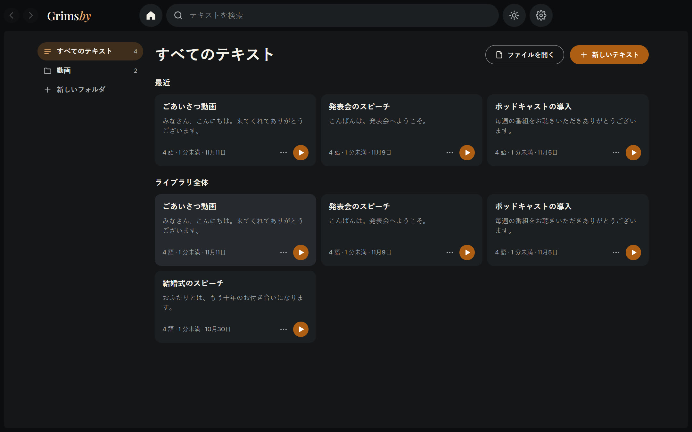
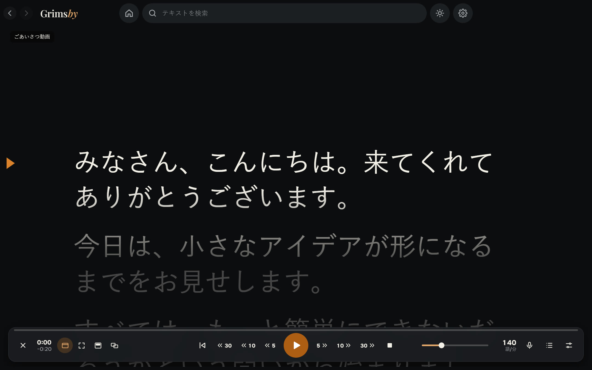
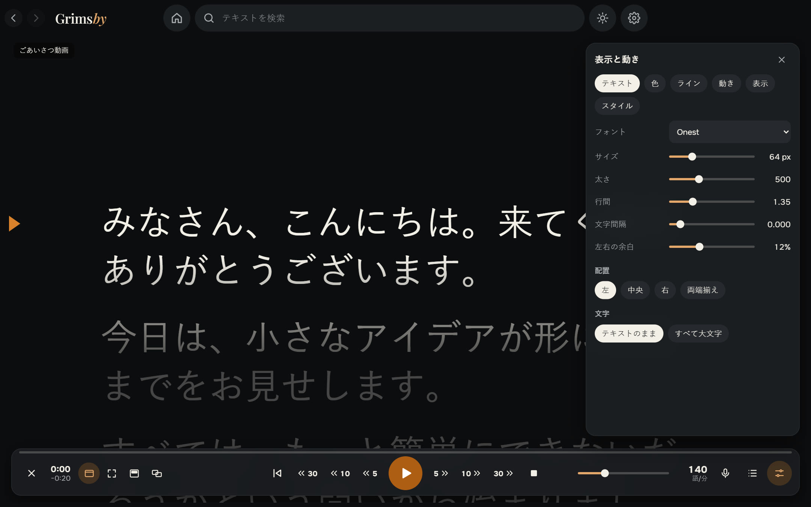
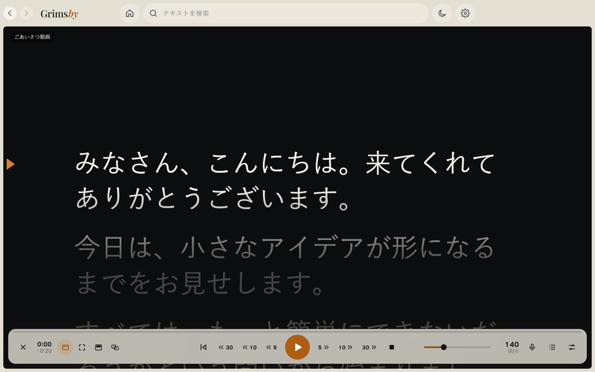

  <a href="README.md">English</a> ·
  <a href="README.ru.md">Русский</a> ·
  <a href="README.es.md">Español</a> ·
  <a href="README.pt.md">Português</a> ·
  <a href="README.de.md">Deutsch</a> ·
  <a href="README.fr.md">Français</a> ·
  <a href="README.zh.md">中文</a> ·
  <b>日本語</b> ·
  <a href="README.ko.md">한국어</a>

  

  <b>声についてくる、Windows 用のシンプルなプロンプター。</b> 
  テキストを貼り付けて開始を押し、読むだけ。なめらかなスクロール、オフラインの音声追従、ほかのウィンドウの最前面にもセカンドモニターにも表示できます。

  
  
  
  
  

  <a href="https://github.com/maksimkhatskevich/grimsby-prompter/releases/latest"><b>⬇ Windows 版をダウンロード</b></a>
  &nbsp;·&nbsp;
  <a href="#機能">機能</a>
  &nbsp;·&nbsp;
  <a href="#プライバシー">プライバシー</a>
  &nbsp;·&nbsp;
  <a href="#お問い合わせ">お問い合わせ</a>

---

## Grimsby Prompter を選ぶ理由

画面の原稿を自然に読めるのは、テキストが自分のペースについてくるときだけです。多くのプロンプターは一定の速度で流れるだけか、便利な設定が奥深いメニューに隠れています。

**Grimsby Prompter はシンプルです。** 大事なものはすぐ目に入り、細かい設定はしまってあります。開始を押して読むだけ。テキストはあなたのペースで進むか、声についていきます。

---

## 機能

### 📚 原稿をひとつの場所に

フォルダーと検索のあるライブラリ。テキストを貼り付けるか、txt、md、rtf、docx、pdf を開くか、ファイルをウィンドウにドロップするだけ。すべて自動で保存され、どの原稿も読んだ位置を覚えています。

### 🎬 なめらかな読み上げ

やわらかな加速と停止、読みながら変えられる速度、上下のテキストを暗くする読み取りライン。連続スクロールのほか、行・段落・ページ単位のモードも。5、10、30 秒戻る・進むは、速度を変えていても読んだ分どおりに動きます。**指定時間に収める**で速度を自動で計算します。

### 🎙 声についてくる

話せば進み、黙れば待ち、一文を飛ばしたりアドリブを入れたりしても正しい位置を見つけます。認識はパソコンの中で 9 言語に対応。言語モデルは同意したときに一度だけダウンロードされ、その後はインターネットなしで動きます。マイクはこのモードのときだけオンになり、音声は保存も送信もされません。

### 🖥 必要な場所にテキストを

ウィンドウでも全画面でも。すべてのアプリの最前面に半透明の帯を出して、Web カメラのすぐ下に置くこともできます。セカンドモニターに全画面表示して、操作はメイン画面で。プロンプター用ガラス向けに左右・上下の鏡像表示も。

### 🎨 見た目と動き

フォント、サイズ、太さ、行間と字間、余白、揃え方、すべて大文字。文字色と背景色、またはグラデーション。既成のスタイルと自分のスタイル。ホットキーは変更でき、グローバルホットキーはほかのアプリを操作中でも使えます。

🌍 **9 言語：** 英語、ロシア語、スペイン語、ポルトガル語、ドイツ語、フランス語、中国語、日本語、韓国語。設定で切り替えるとすぐに反映されます。

ライトテーマもワンクリック。上の太陽ボタンです。

---

## ダウンロードとインストール

1. **[最新バージョン](https://github.com/maksimkhatskevich/grimsby-prompter/releases/latest)** のページを開き、インストーラー `.exe` をダウンロードします。
2. 実行します。Windows に青い「Windows によって PC が保護されました」画面が出ることがありますが、有料の署名証明書がないアプリでは普通の警告です。**詳細情報 → 実行** をクリックしてください。
   インストーラーは VirusTotal で確認済みです：[67 のウイルス対策エンジンすべてで検出なし](https://www.virustotal.com/gui/file/21cec8155312cbb75dcf7c4b22757e0e21429176e19869b34bfa85b5cb0c2b19)（バージョン 1.0.0）。
3. **新しいテキスト** をクリックするか、ファイルをウィンドウにドロップします。

**動作環境：** Windows 10 / 11（64 ビット）。

---

## プライバシー

Grimsby Prompter はあなたのパソコンの中で動きます。原稿はそこにだけ保存され、マイクの音声は保存も送信もされません。アカウントも広告も分析もありません。インターネットにつなぐのは、選んだ音声モデルのダウンロードとアップデートの確認のときだけです。

---

## Grimsby のアプリ

<table>
  <tr>
    <td align="center" width="20%"><a href="https://github.com/maksimkhatskevich/grimsby-releases/blob/main/README.ja.md"> <b>Grimsby Player</b></a> ダウンロードした音楽と MV のためのオフラインプレーヤー</td>
    <td align="center" width="20%"><a href="https://github.com/maksimkhatskevich/grimsby-converter/blob/main/README.ja.md"> <b>Grimsby Converter</b></a> 動画・音声・写真・文書をオフラインで変換</td>
    <td align="center" width="20%"><a href="https://github.com/maksimkhatskevich/grimsby-tagger/blob/main/README.ja.md"> <b>Grimsby Tagger</b></a> タグ一括編集：アルバム、カバー、ファイル名</td>
    <td align="center" width="20%"> <b>Grimsby Prompter</b> </td>
    <td align="center" width="20%"><a href="https://github.com/maksimkhatskevich/grimsby-helper/blob/main/README.ja.md"> <b>Grimsby Helper</b></a> PC の状態がひと目でわかる：プロセス、温度、クリーンアップ</td>
  </tr>
</table>

---

## お問い合わせ

不具合を見つけた、アイデアがある、またはお礼を伝えたい？ご連絡ください：

- ✉️ メール: **[grimsbyy@gmail.com](mailto:grimsbyy@gmail.com)**
- 🐞 不具合とアイデア: [Issues](https://github.com/maksimkhatskevich/grimsby-prompter/issues)
- 📣 Telegram：[@itsgrimsby](https://t.me/itsgrimsby)（ロシア語）

---

## ライセンス

Grimsby Prompter は、Electron、React、オフライン音声認識エンジンとその言語モデルなどのオープンソースコンポーネントを使用しています。ライセンス本文付きの一覧は、プログラムフォルダーの `THIRD_PARTY_NOTICES.txt` にあります。

© 2026 Grimsby

