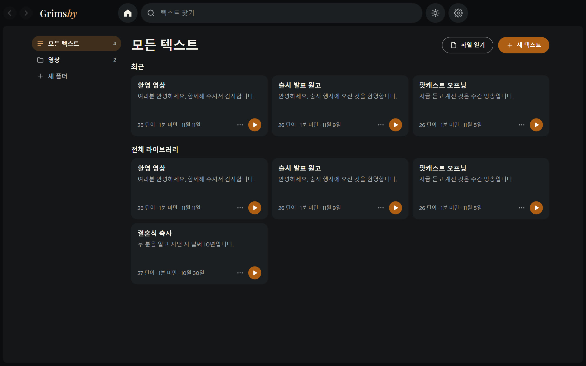
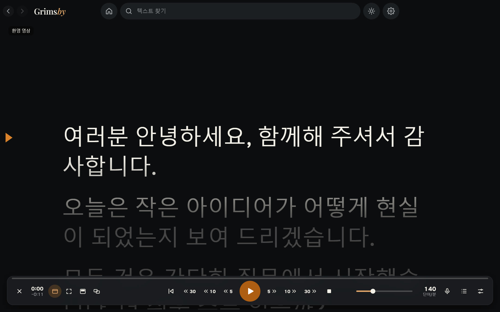
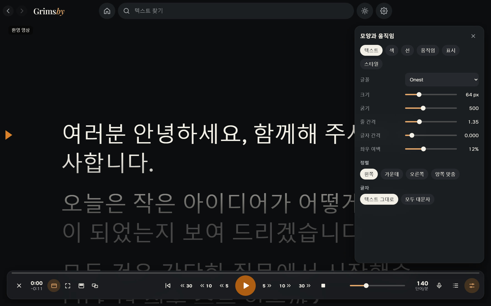
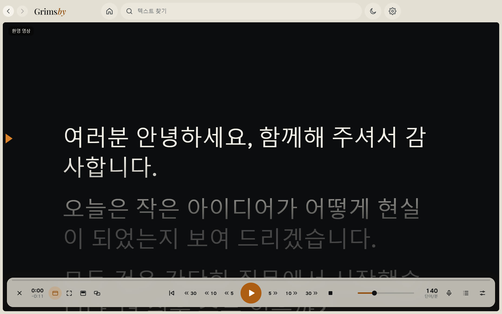

  <a href="README.md">English</a> ·
  <a href="README.ru.md">Русский</a> ·
  <a href="README.es.md">Español</a> ·
  <a href="README.pt.md">Português</a> ·
  <a href="README.de.md">Deutsch</a> ·
  <a href="README.fr.md">Français</a> ·
  <a href="README.zh.md">中文</a> ·
  <a href="README.ja.md">日本語</a> ·
  <b>한국어</b>

  

  <b>목소리를 따라가는 Windows용 간단한 프롬프터.</b> 
  텍스트를 붙여 넣고 시작을 누른 뒤 읽으세요. 부드러운 스크롤, 오프라인 음성 따라가기, 다른 창 위에도 보조 모니터에도 띄울 수 있습니다.

  
  
  
  
  

  <a href="https://github.com/maksimkhatskevich/grimsby-prompter/releases/latest"><b>⬇ Windows용 다운로드</b></a>
  &nbsp;·&nbsp;
  <a href="#기능">기능</a>
  &nbsp;·&nbsp;
  <a href="#개인정보">개인정보</a>
  &nbsp;·&nbsp;
  <a href="#문의">문의</a>

---

## 왜 Grimsby Prompter인가

화면을 보고 읽는 모습이 자연스러우려면 텍스트가 내 속도를 따라와야 합니다. 많은 프롬프터는 일정한 속도로만 흐르거나 쓸모 있는 설정을 끝없는 메뉴 속에 숨겨 둡니다.

**Grimsby Prompter는 간단합니다.** 꼭 필요한 것은 바로 보이고, 세부 설정은 따로 정리되어 있습니다. 시작을 누르고 읽기만 하세요. 텍스트가 내 속도에 맞춰 흐르거나 목소리를 따라갑니다.

---

## 기능

### 📚 모든 텍스트를 한곳에

폴더와 검색이 있는 보관함입니다. 텍스트를 붙여 넣거나 txt, md, rtf, docx, pdf를 열고, 그냥 파일을 창에 끌어다 놓아도 됩니다. 모든 것이 자동으로 저장되고, 텍스트마다 읽던 위치를 기억합니다.

### 🎬 부드러운 읽기

부드러운 출발과 정지, 읽는 중에도 바꿀 수 있는 속도, 위아래 텍스트를 어둡게 하는 읽기 선. 연속 스크롤 또는 줄·단락·페이지 모드. 5초, 10초, 30초 뒤로·앞으로 이동은 속도가 바뀌었어도 이미 읽은 만큼 정확히 움직입니다. **지정 시간에 맞추기**가 속도를 대신 계산합니다.

### 🎙 목소리를 따라갑니다

말하면 텍스트가 움직이고, 멈추면 기다리고, 한 문장을 건너뛰거나 즉흥으로 말해도 맞는 위치를 찾습니다. 인식은 내 컴퓨터에서 9개 언어로 동작합니다. 언어 모델은 동의할 때 한 번만 내려받고, 그다음에는 인터넷 없이 동작합니다. 마이크는 이 모드에서만 켜지고, 소리는 저장되거나 어디로도 전송되지 않습니다.

### 🖥 필요한 곳에 텍스트를

창 또는 전체 화면. 모든 앱 위에 반투명 띠를 띄워 웹캠 바로 아래에 둘 수 있습니다. 보조 모니터에는 전체 화면으로, 조작은 기본 모니터에서. 프롬프터 유리용으로 가로·세로 거울 모드도 있습니다.

### 🎨 모양과 움직임

글꼴, 크기, 굵기, 줄 간격과 자간, 여백, 정렬, 모두 대문자. 글자색과 배경색 또는 그라데이션. 기본 스타일과 나만의 스타일. 단축키는 바꿀 수 있고, 전역 단축키는 다른 앱을 쓰는 중에도 동작합니다.

🌍 **9개 언어:** 영어, 러시아어, 스페인어, 포르투갈어, 독일어, 프랑스어, 중국어, 일본어, 한국어 — 설정에서 바꾸면 바로 적용됩니다.

라이트 테마도 클릭 한 번, 위쪽의 해 모양 버튼입니다.

---

## 다운로드 및 설치

1. **[최신 버전](https://github.com/maksimkhatskevich/grimsby-prompter/releases/latest)** 페이지를 열고 설치 프로그램 `.exe`를 다운로드하세요.
2. 실행하세요. Windows가 파란색 "Windows의 PC 보호" 창을 띄울 수 있는데, 유료 코드 서명 인증서가 없는 프로그램에 대한 일반적인 경고입니다. **추가 정보 → 실행**을 누르세요.
   설치 프로그램은 VirusTotal에서 검사했습니다: [백신 엔진 67개 모두 이상 없음](https://www.virustotal.com/gui/file/21cec8155312cbb75dcf7c4b22757e0e21429176e19869b34bfa85b5cb0c2b19) (버전 1.0.0).
3. **새 텍스트** 를 누르거나 파일을 창에 끌어다 놓으세요.

**요구 사항:** Windows 10 또는 11(64비트). 마이크는 음성 따라가기에만 필요합니다. 인터넷은 음성 모델을 내려받고 업데이트를 확인할 때만 필요합니다.

---

## 개인정보

Grimsby Prompter는 내 컴퓨터에서 동작합니다. 텍스트는 그곳에만 저장되고, 마이크 소리는 저장되거나 전송되지 않습니다. 계정도 광고도 분석도 없습니다. 인터넷에는 직접 고른 음성 모델을 내려받거나 업데이트를 확인할 때만 연결합니다.

---

## Grimsby 앱

<table>
  <tr>
    <td align="center" width="20%"><a href="https://github.com/maksimkhatskevich/grimsby-releases/blob/main/README.ko.md"> <b>Grimsby Player</b></a> 다운로드한 음악과 뮤직비디오를 위한 오프라인 플레이어</td>
    <td align="center" width="20%"><a href="https://github.com/maksimkhatskevich/grimsby-converter/blob/main/README.ko.md"> <b>Grimsby Converter</b></a> 영상, 오디오, 사진, 문서를 오프라인으로 변환</td>
    <td align="center" width="20%"><a href="https://github.com/maksimkhatskevich/grimsby-tagger/blob/main/README.ko.md"> <b>Grimsby Tagger</b></a> 태그 일괄 편집: 앨범, 커버, 파일 이름</td>
    <td align="center" width="20%"> <b>Grimsby Prompter</b> </td>
    <td align="center" width="20%"><a href="https://github.com/maksimkhatskevich/grimsby-helper/blob/main/README.ko.md"> <b>Grimsby Helper</b></a> PC 상태를 한눈에: 프로세스, 온도, 정리</td>
  </tr>
</table>

---

## 문의

버그를 찾았거나, 아이디어가 있거나, 그냥 고맙다고 말하고 싶다면 연락 주세요:

- ✉️ 이메일: **[grimsbyy@gmail.com](mailto:grimsbyy@gmail.com)**
- 🐞 버그와 아이디어: [Issues](https://github.com/maksimkhatskevich/grimsby-prompter/issues)
- 📣 Telegram: [@itsgrimsby](https://t.me/itsgrimsby) (러시아어)

---

## 라이선스

Grimsby Prompter는 Electron, React, 오프라인 음성 인식 엔진과 언어 모델 등 오픈 소스 구성 요소를 사용합니다. 라이선스 전문이 포함된 전체 목록은 프로그램 폴더의 `THIRD_PARTY_NOTICES.txt`에 있습니다.

© 2026 Grimsby

