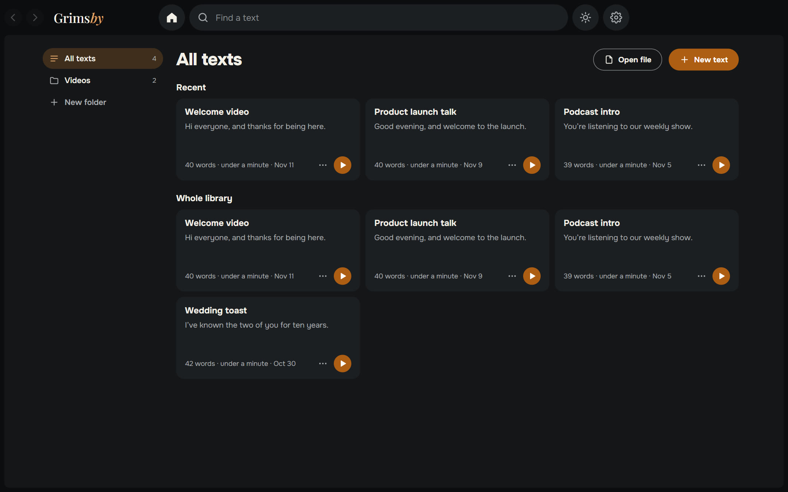
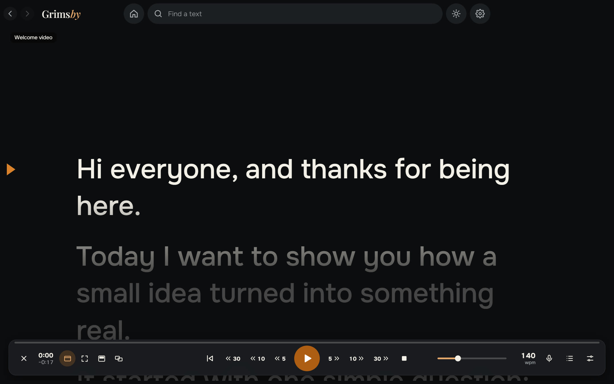
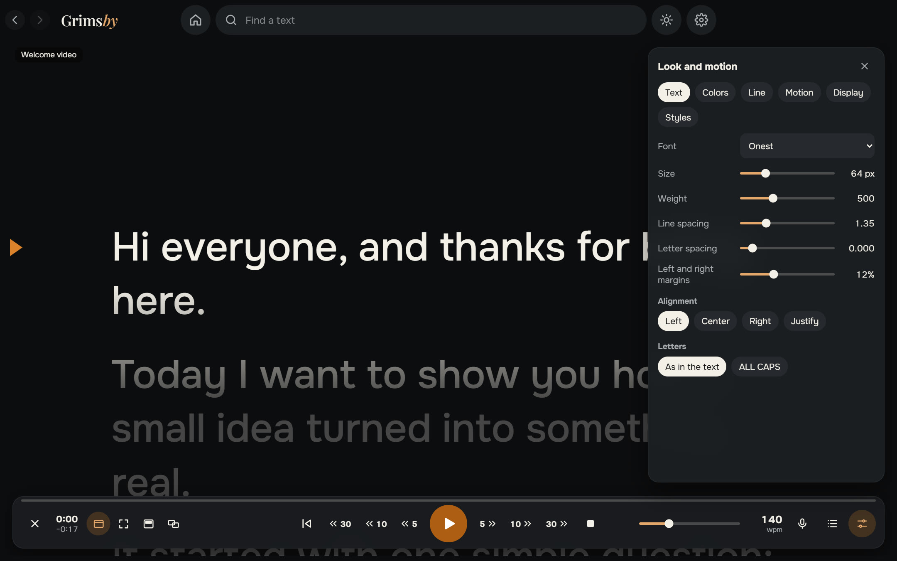
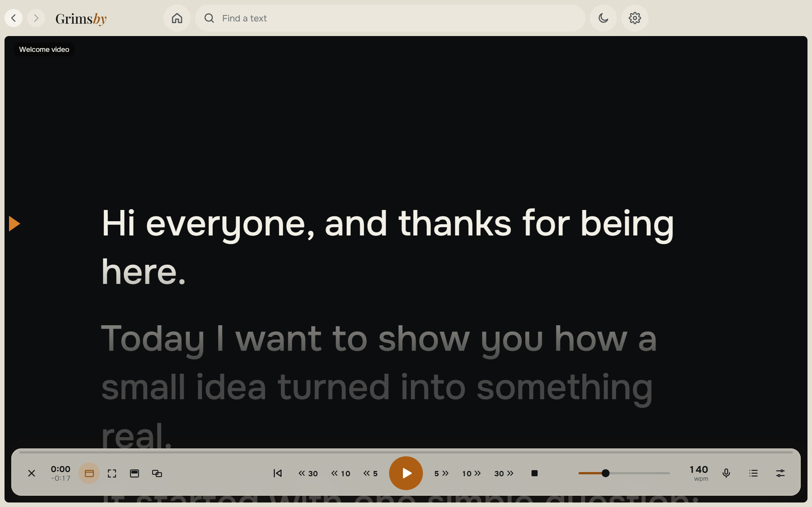

  <b>English</b> ·
  <a href="README.ru.md">Русский</a> ·
  <a href="README.es.md">Español</a> ·
  <a href="README.pt.md">Português</a> ·
  <a href="README.de.md">Deutsch</a> ·
  <a href="README.fr.md">Français</a> ·
  <a href="README.zh.md">中文</a> ·
  <a href="README.ja.md">日本語</a> ·
  <a href="README.ko.md">한국어</a>

  

  <b>A simple teleprompter for Windows that follows your voice.</b> 
  Paste your text, press start and read: smooth scrolling, offline voice following, on top of other windows or on a second monitor.

  
  
  
  
  

  <a href="https://github.com/maksimkhatskevich/grimsby-prompter/releases/latest"><b>⬇ Download for Windows</b></a>
  &nbsp;·&nbsp;
  <a href="#features">Features</a>
  &nbsp;·&nbsp;
  <a href="#privacy">Privacy</a>
  &nbsp;·&nbsp;
  <a href="#feedback">Feedback</a>

---

## Why Grimsby Prompter

Reading from a screen looks natural only when the text keeps up with you. Many teleprompters either scroll at a fixed speed or hide the useful settings in endless menus.

**Grimsby Prompter keeps it simple.** The essentials are on screen right away, the fine-tuning is tucked away. Press start and read: the text moves at your pace or follows your voice.

---

## Features

### 📚 Your texts in one place

A library with folders and search. Paste text or open txt, md, rtf, docx and pdf — or just drop a file into the window. Everything is saved automatically, and every text remembers where you stopped reading.

### 🎬 Smooth reading

A soft start and stop, speed you can change while reading, and a reading line with the text above and below dimmed. Continuous scrolling, or line, paragraph and page modes. Jump back or forward 5, 10 or 30 seconds — exactly over what you have already read, even if the speed changed. **Fit into a set time** picks the speed for you.

### 🎙 Follows your voice

Speak and the text moves; pause and it waits; skip a phrase or improvise and it finds the right place. Recognition runs on your computer in 9 languages: a language model is downloaded once, only when you agree, and then works without internet. The microphone is on only in this mode, and the sound is never saved or sent anywhere.

### 🖥 Wherever you need the text

In a window or full screen; a semi-transparent strip on top of all apps that you can place right under your webcam; full screen on a second monitor with the controls on the main one; mirrored horizontally or vertically for teleprompter glass.

### 🎨 Look and motion

Font, size, weight, line and letter spacing, margins, alignment and ALL CAPS. Text and background colors or a gradient. Ready-made styles and your own. Hotkeys can be changed, and global hotkeys work even while another app is active.

🌍 **9 languages:** English, Russian, Spanish, Portuguese, German, French, Chinese, Japanese and Korean — switch in Settings, it changes right away.

The light theme is one click away — the sun button at the top.

---

## Download and install

1. Open the **[latest release](https://github.com/maksimkhatskevich/grimsby-prompter/releases/latest)** page and download the installer `.exe`.
2. Run it. Windows may show a blue "Windows protected your PC" window — that's a normal warning for apps without a paid code-signing certificate. Click **More info → Run anyway**.
   The installer has been checked on VirusTotal: [0 of 67 antivirus engines flag it](https://www.virustotal.com/gui/file/21cec8155312cbb75dcf7c4b22757e0e21429176e19869b34bfa85b5cb0c2b19) (version 1.0.0).
3. Click **New text** or drop a file into the window.

**Requirements:** Windows 10 or 11 (64-bit). A microphone is needed only for voice following. Internet is needed only to download a voice model and to check for updates.

---

## Privacy

Grimsby Prompter works on your computer. Your texts are stored only there, and the sound from the microphone is never saved or sent anywhere. No accounts, no ads, no analytics. The app goes online only to download a voice model you chose and to check for updates.

---

## Grimsby apps

<table>
  <tr>
    <td align="center" width="20%"><a href="https://github.com/maksimkhatskevich/grimsby-releases"> <b>Grimsby Player</b></a> Offline music & video player for your downloaded collection</td>
    <td align="center" width="20%"><a href="https://github.com/maksimkhatskevich/grimsby-converter"> <b>Grimsby Converter</b></a> Video, audio, photos and documents — converted offline</td>
    <td align="center" width="20%"><a href="https://github.com/maksimkhatskevich/grimsby-tagger"> <b>Grimsby Tagger</b></a> Batch tag editor: albums, covers, file names</td>
    <td align="center" width="20%"> <b>Grimsby Prompter</b> </td>
    <td align="center" width="20%"><a href="https://github.com/maksimkhatskevich/grimsby-helper"> <b>Grimsby Helper</b></a> PC health at a glance: processes, temperatures, cleanup</td>
  </tr>
</table>

---

## Feedback

Found a bug, have an idea or just want to say thanks? Get in touch:

- ✉️ email: **[grimsbyy@gmail.com](mailto:grimsbyy@gmail.com)**
- 🐞 bugs and ideas: [Issues](https://github.com/maksimkhatskevich/grimsby-prompter/issues)
- 📣 Telegram: [@itsgrimsby](https://t.me/itsgrimsby) (in Russian)

---

## Licenses

Grimsby Prompter uses open-source components, including Electron, React and an offline speech recognition engine with its language models. The full list with license texts is in `THIRD_PARTY_NOTICES.txt` in the program folder.

© 2026 Grimsby

