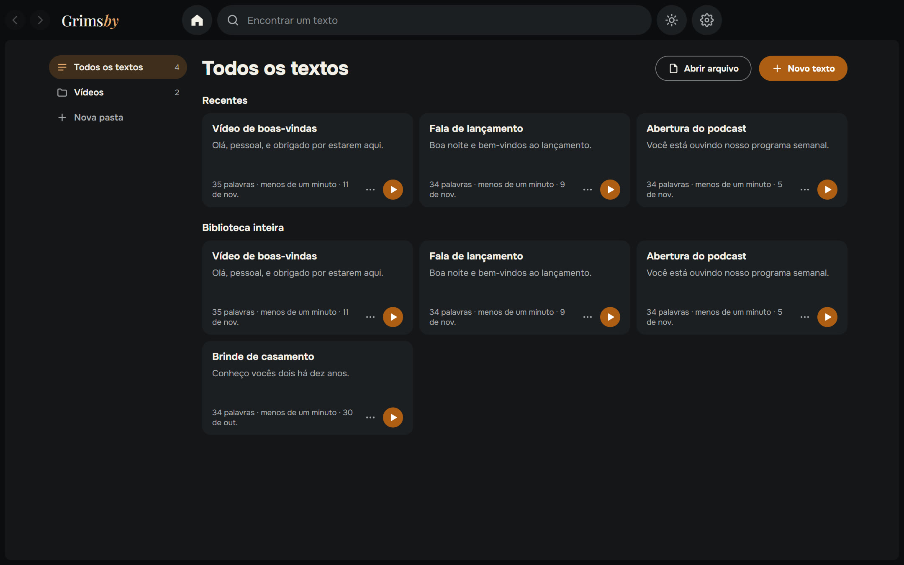
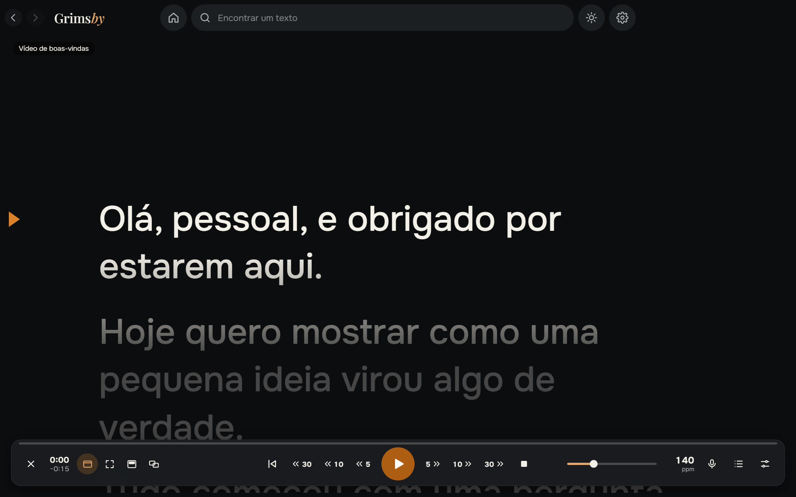
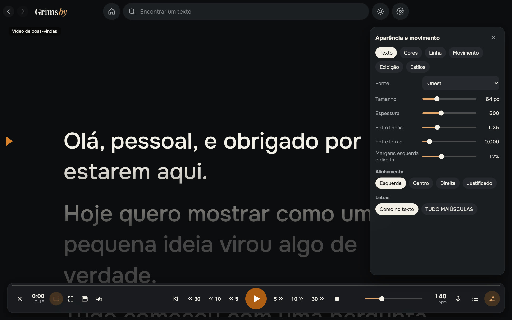
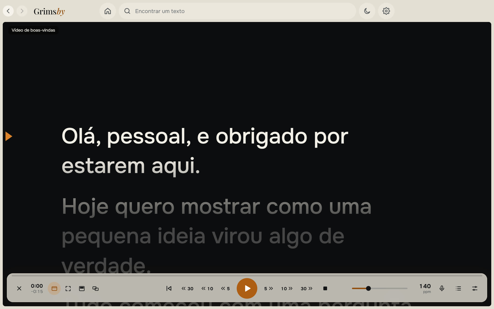

  <a href="README.md">English</a> ·
  <a href="README.ru.md">Русский</a> ·
  <a href="README.es.md">Español</a> ·
  <b>Português</b> ·
  <a href="README.de.md">Deutsch</a> ·
  <a href="README.fr.md">Français</a> ·
  <a href="README.zh.md">中文</a> ·
  <a href="README.ja.md">日本語</a> ·
  <a href="README.ko.md">한국어</a>

  

  <b>Um teleprompter simples para Windows que acompanha sua voz.</b> 
  Cole o texto, aperte iniciar e leia: rolagem suave, acompanhamento de voz offline, sobre outras janelas ou em um segundo monitor.

  
  
  
  
  

  <a href="https://github.com/maksimkhatskevich/grimsby-prompter/releases/latest"><b>⬇ Baixar para Windows</b></a>
  &nbsp;·&nbsp;
  <a href="#recursos">Recursos</a>
  &nbsp;·&nbsp;
  <a href="#privacidade">Privacidade</a>
  &nbsp;·&nbsp;
  <a href="#contato">Contato</a>

---

## Por que o Grimsby Prompter

Ler da tela só parece natural quando o texto acompanha você. Muitos teleprompters rolam numa velocidade fixa ou escondem os ajustes úteis em menus sem fim.

**O Grimsby Prompter é simples.** O essencial aparece logo, os ajustes finos ficam guardados. Aperte iniciar e leia: o texto anda no seu ritmo ou acompanha sua voz.

---

## Recursos

### 📚 Seus textos em um só lugar

Uma biblioteca com pastas e busca. Cole um texto ou abra txt, md, rtf, docx e pdf — ou simplesmente arraste um arquivo para a janela. Tudo é salvo automaticamente, e cada texto lembra onde você parou.

### 🎬 Leitura suave

Partida e parada suaves, velocidade que muda durante a leitura e uma linha de leitura que escurece o texto acima e abaixo. Rolagem contínua ou modos por linha, parágrafo e página. Volte ou avance 5, 10 ou 30 segundos — exatamente pelo que você já leu, mesmo que a velocidade tenha mudado. **Caber em um tempo** calcula a velocidade para você.

### 🎙 Acompanha sua voz

Você fala e o texto anda; para e ele espera; pula uma frase ou improvisa e ele encontra o lugar certo. O reconhecimento roda no seu computador em 9 idiomas: o modelo do idioma é baixado uma vez, só com o seu consentimento, e depois funciona sem internet. O microfone só liga nesse modo, e o som nunca é salvo nem enviado para lugar nenhum.

### 🖥 O texto onde você precisa

Em uma janela ou em tela cheia; uma faixa semitransparente sobre todos os apps, que você pode colocar logo abaixo da webcam; em tela cheia num segundo monitor com os controles no principal; espelhado na horizontal ou vertical para o vidro do teleprompter.

### 🎨 Aparência e movimento

Fonte, tamanho, peso, espaçamento entre linhas e letras, margens, alinhamento e TUDO EM MAIÚSCULAS. Cores de texto e fundo ou um degradê. Estilos prontos e os seus. Os atalhos podem ser alterados, e os atalhos globais funcionam mesmo com outro app ativo.

🌍 **9 idiomas:** inglês, russo, espanhol, português, alemão, francês, chinês, japonês e coreano — troque nas Configurações, muda na hora.

O tema claro fica a um clique — o botão do sol, no alto.

---

## Baixar e instalar

1. Abra a página da **[versão mais recente](https://github.com/maksimkhatskevich/grimsby-prompter/releases/latest)** e baixe o instalador `.exe`.
2. Execute-o. O Windows pode mostrar uma janela azul «O Windows protegeu o computador» — é um aviso normal para programas sem certificado de assinatura pago. Clique em **Mais informações → Executar assim mesmo**.
   O instalador foi verificado no VirusTotal: [nenhum dos 67 antivírus encontrou nada](https://www.virustotal.com/gui/file/21cec8155312cbb75dcf7c4b22757e0e21429176e19869b34bfa85b5cb0c2b19) (versão 1.0.0).
3. Clique em **Novo texto** ou arraste um arquivo para a janela.

**Requisitos:** Windows 10 ou 11 (64 bits). O microfone só é necessário para acompanhar a voz. A internet só é necessária para baixar um modelo de voz e verificar atualizações.

---

## Privacidade

O Grimsby Prompter funciona no seu computador. Seus textos ficam guardados só nele, e o som do microfone nunca é salvo nem enviado. Sem contas, sem anúncios, sem análises. O app só se conecta para baixar o modelo de voz que você escolher e verificar atualizações.

---

## Os apps Grimsby

<table>
  <tr>
    <td align="center" width="20%"><a href="https://github.com/maksimkhatskevich/grimsby-releases/blob/main/README.pt.md"> <b>Grimsby Player</b></a> Player offline para suas músicas e clipes baixados</td>
    <td align="center" width="20%"><a href="https://github.com/maksimkhatskevich/grimsby-converter/blob/main/README.pt.md"> <b>Grimsby Converter</b></a> Vídeo, áudio, fotos e documentos convertidos offline</td>
    <td align="center" width="20%"><a href="https://github.com/maksimkhatskevich/grimsby-tagger/blob/main/README.pt.md"> <b>Grimsby Tagger</b></a> Editor de tags em lote: álbuns, capas, nomes de arquivos</td>
    <td align="center" width="20%"> <b>Grimsby Prompter</b> </td>
    <td align="center" width="20%"><a href="https://github.com/maksimkhatskevich/grimsby-helper/blob/main/README.pt.md"> <b>Grimsby Helper</b></a> A saúde do PC de relance: processos, temperaturas, limpeza</td>
  </tr>
</table>

---

## Contato

Encontrou um erro, tem uma ideia ou só quer agradecer? Escreva:

- ✉️ e-mail: **[grimsbyy@gmail.com](mailto:grimsbyy@gmail.com)**
- 🐞 erros e ideias: [Issues](https://github.com/maksimkhatskevich/grimsby-prompter/issues)
- 📣 Telegram: [@itsgrimsby](https://t.me/itsgrimsby) (em russo)

---

## Licenças

O Grimsby Prompter usa componentes de código aberto, entre eles Electron, React e um mecanismo de reconhecimento de voz offline com seus modelos de idioma. A lista completa com os textos das licenças está em `THIRD_PARTY_NOTICES.txt`, na pasta do programa.

© 2026 Grimsby

