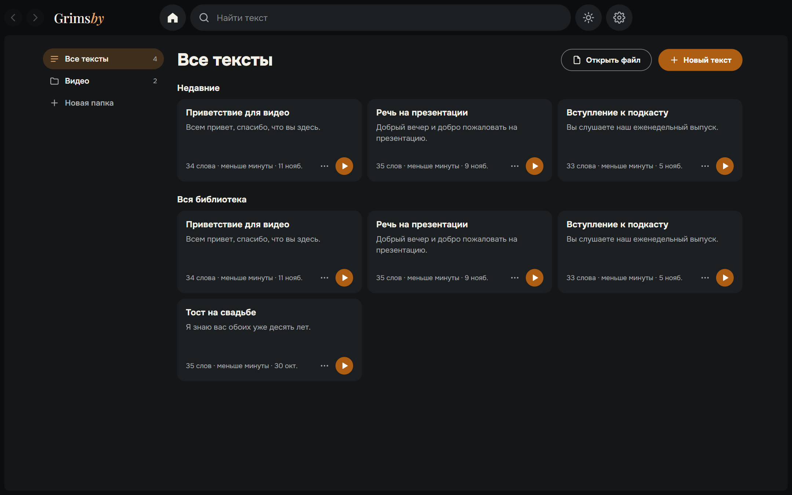
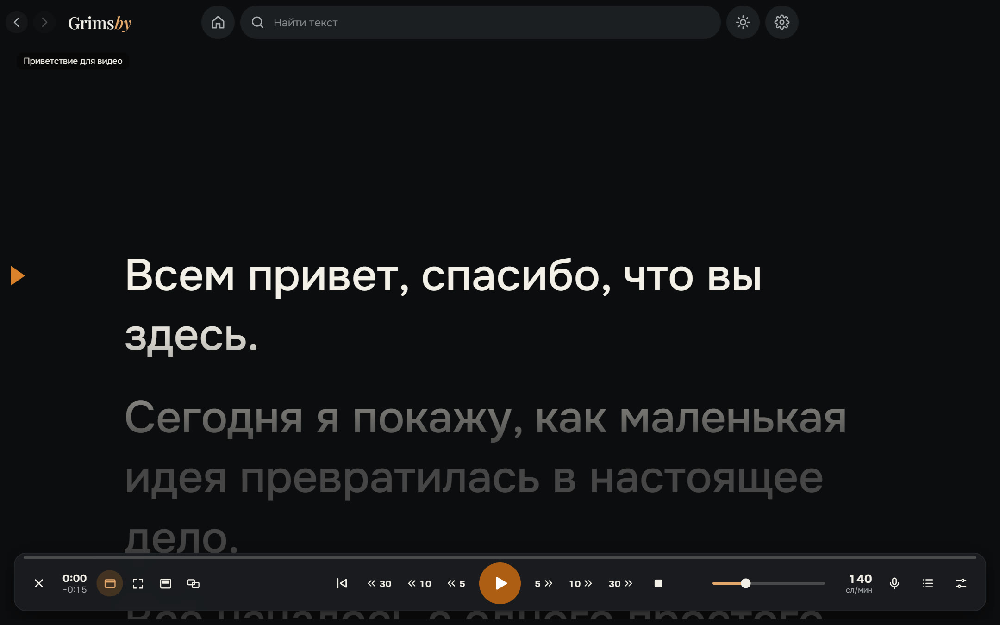
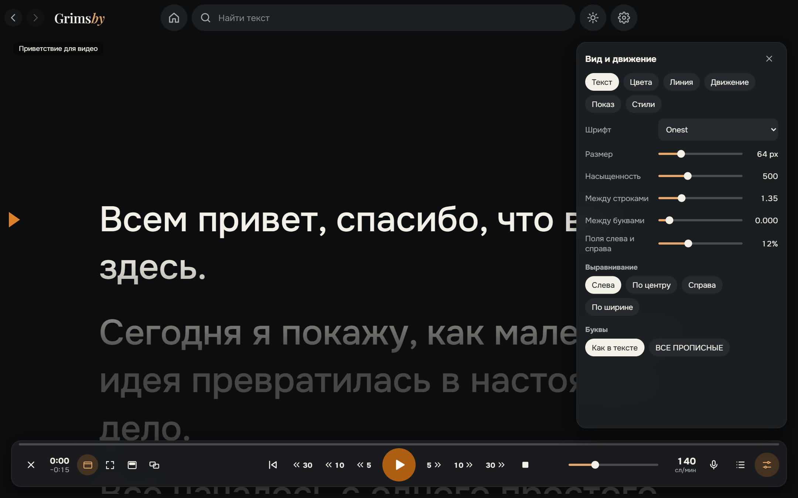
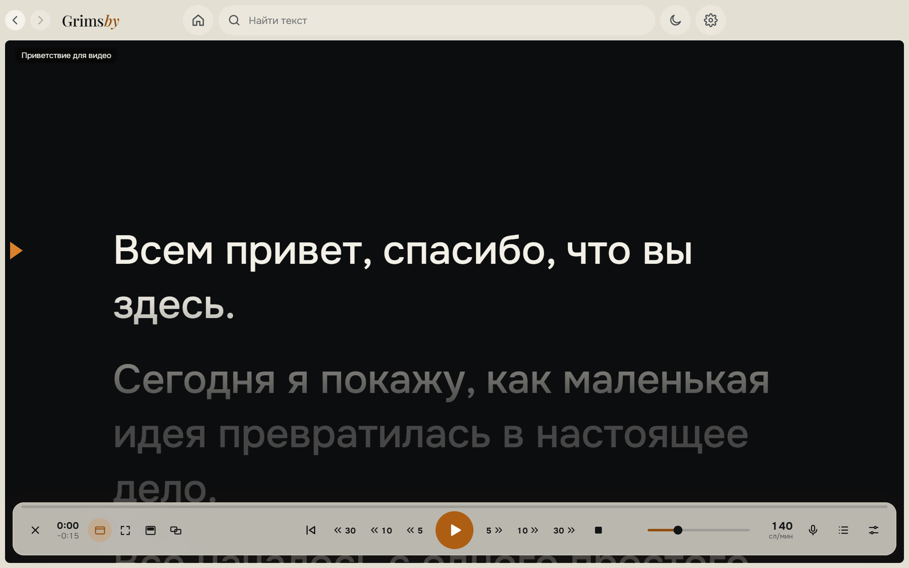

  <a href="README.md">English</a> ·
  <b>Русский</b> ·
  <a href="README.es.md">Español</a> ·
  <a href="README.pt.md">Português</a> ·
  <a href="README.de.md">Deutsch</a> ·
  <a href="README.fr.md">Français</a> ·
  <a href="README.zh.md">中文</a> ·
  <a href="README.ja.md">日本語</a> ·
  <a href="README.ko.md">한국어</a>

  

  <b>Простой телесуфлёр для Windows, который следует за голосом.</b> 
  Вставьте текст, нажмите запуск и читайте: плавное движение, следование за голосом без интернета, поверх других окон или на втором мониторе.

  
  
  
  
  

  <a href="https://github.com/maksimkhatskevich/grimsby-prompter/releases/latest"><b>⬇ Скачать для Windows</b></a>
  &nbsp;·&nbsp;
  <a href="#возможности">Возможности</a>
  &nbsp;·&nbsp;
  <a href="#приватность">Приватность</a>
  &nbsp;·&nbsp;
  <a href="#обратная-связь">Обратная связь</a>

---

## Зачем Grimsby Prompter

Чтение с экрана выглядит естественно, только когда текст успевает за вами. Многие суфлёры либо крутят текст с одной скоростью, либо прячут полезные настройки в бесконечных меню.

**Grimsby Prompter остаётся простым.** Главное видно сразу, тонкие настройки спрятаны. Нажмите запуск и читайте: текст идёт в вашем темпе или следует за голосом.

---

## Возможности

### 📚 Все тексты в одном месте

Библиотека с папками и поиском. Вставьте текст или откройте txt, md, rtf, docx и pdf — или просто перетащите файл в окно. Всё сохраняется само, и каждый текст помнит, где вы остановились.

### 🎬 Плавное чтение

Мягкий разгон и торможение, скорость меняется прямо во время чтения, линия чтения с затемнением текста выше и ниже. Непрерывное движение или режимы по строкам, абзацам и страницам. Отмотка назад и вперёд на 5, 10 или 30 секунд — ровно по тому, что уже прочитано, даже если скорость менялась. **Уложиться в заданное время** — скорость посчитается сама.

### 🎙 Следует за голосом

Говорите — текст движется, замолчали — ждёт, пропустили фразу или импровизируете — находит нужное место. Распознавание работает на вашем компьютере на 9 языках: модель языка скачивается один раз, только с вашего согласия, и дальше работает без интернета. Микрофон включается только в этом режиме, звук не сохраняется и никуда не отправляется.

### 🖥 Текст там, где нужно

В окне или на весь экран; полупрозрачная полоса поверх всех программ, которую можно поставить прямо под веб-камерой; на весь экран на втором мониторе, а управление — на основном; зеркально по горизонтали или вертикали для стекла суфлёра.

### 🎨 Вид и движение

Шрифт, размер, насыщенность, межстрочный и межбуквенный интервал, поля, выравнивание и ВСЕ ПРОПИСНЫЕ. Цвет текста и фона или градиент. Готовые стили и свои. Горячие клавиши настраиваются, а глобальные работают, даже когда активна другая программа.

🌍 **9 языков:** русский, английский, испанский, португальский, немецкий, французский, китайский, японский и корейский — переключаются в настройках сразу.

Светлая тема — в один клик, кнопка с солнцем вверху.

---

## Скачать и установить

1. Откройте страницу **[последней версии](https://github.com/maksimkhatskevich/grimsby-prompter/releases/latest)** и скачайте установщик `.exe`.
2. Запустите его. Windows может показать синее окно «Система Windows защитила ваш компьютер» — это обычное предупреждение для программ без платного сертификата подписи. Нажмите **Подробнее → Выполнить в любом случае**.
   Установщик проверен на VirusTotal: [ни один из 67 антивирусов ничего не нашёл](https://www.virustotal.com/gui/file/21cec8155312cbb75dcf7c4b22757e0e21429176e19869b34bfa85b5cb0c2b19) (версия 1.0.0).
3. Нажмите **«Новый текст»** или перетащите файл в окно.

**Требования:** Windows 10 или 11 (64 бит). Микрофон нужен только для следования за голосом. Интернет нужен только чтобы скачать модель голоса и проверить обновления.

---

## Приватность

Grimsby Prompter работает на вашем компьютере. Тексты хранятся только на нём, звук с микрофона не сохраняется и никуда не отправляется. Без аккаунтов, рекламы и аналитики. В интернет программа выходит, только чтобы скачать выбранную вами модель голоса и проверить обновления.

---

## Программы Grimsby

<table>
  <tr>
    <td align="center" width="20%"><a href="https://github.com/maksimkhatskevich/grimsby-releases/blob/main/README.ru.md"> <b>Grimsby Player</b></a> Офлайн-плеер для скачанной музыки и клипов</td>
    <td align="center" width="20%"><a href="https://github.com/maksimkhatskevich/grimsby-converter/blob/main/README.ru.md"> <b>Grimsby Converter</b></a> Видео, аудио, фото и документы — конвертация без интернета</td>
    <td align="center" width="20%"><a href="https://github.com/maksimkhatskevich/grimsby-tagger/blob/main/README.ru.md"> <b>Grimsby Tagger</b></a> Пакетный редактор тегов: альбомы, обложки, имена файлов</td>
    <td align="center" width="20%"> <b>Grimsby Prompter</b> </td>
    <td align="center" width="20%"><a href="https://github.com/maksimkhatskevich/grimsby-helper/blob/main/README.ru.md"> <b>Grimsby Helper</b></a> Состояние ПК с первого взгляда: процессы, температуры, чистка</td>
  </tr>
</table>

---

## Обратная связь

Нашли ошибку, есть идея или просто хотите сказать спасибо? Пишите:

- ✉️ почта: **[grimsbyy@gmail.com](mailto:grimsbyy@gmail.com)**
- 🐞 ошибки и идеи: [Issues](https://github.com/maksimkhatskevich/grimsby-prompter/issues)
- 📣 Telegram: [@itsgrimsby](https://t.me/itsgrimsby)

---

## Лицензии

Grimsby Prompter использует компоненты с открытым кодом, в том числе Electron, React и офлайн-движок распознавания речи с моделями языков. Полный список с текстами лицензий — в файле `THIRD_PARTY_NOTICES.txt` в папке программы.

© 2026 Grimsby

