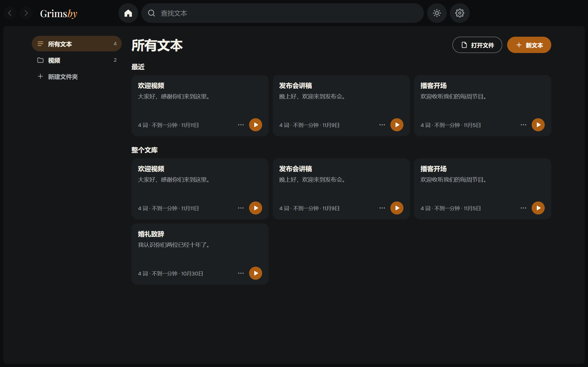
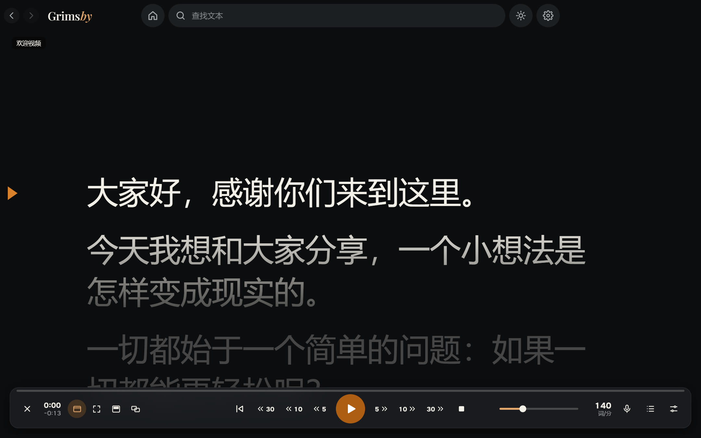
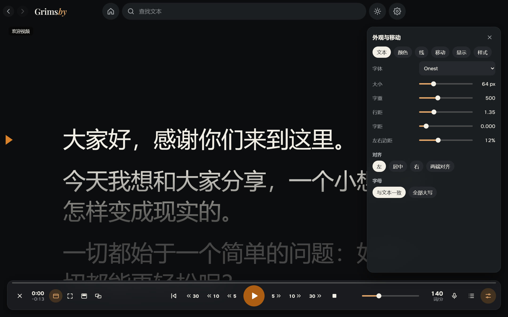
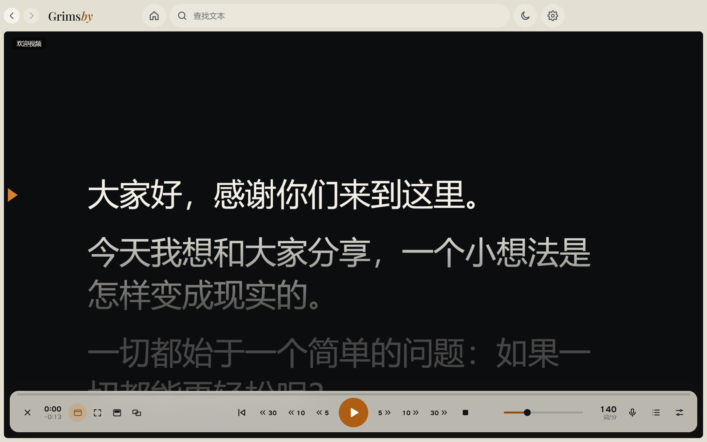

  <a href="README.md">English</a> ·
  <a href="README.ru.md">Русский</a> ·
  <a href="README.es.md">Español</a> ·
  <a href="README.pt.md">Português</a> ·
  <a href="README.de.md">Deutsch</a> ·
  <a href="README.fr.md">Français</a> ·
  <b>中文</b> ·
  <a href="README.ja.md">日本語</a> ·
  <a href="README.ko.md">한국어</a>

  

  <b>会跟随你声音的 Windows 简单提词器。</b> 
  粘贴文稿，按下开始即可朗读：平滑滚动、离线语音跟随，可置顶于其他窗口，也可显示在第二台显示器上。

  
  
  
  

  <a href="https://github.com/maksimkhatskevich/grimsby-prompter/releases/latest"><b>⬇ 下载 Windows 版</b></a>
  &nbsp;·&nbsp;
  <a href="#功能">功能</a>
  &nbsp;·&nbsp;
  <a href="#隐私">隐私</a>
  &nbsp;·&nbsp;
  <a href="#反馈">反馈</a>

---

## 为什么选择 Grimsby Prompter

只有当文字跟得上你的节奏，看着屏幕念稿才显得自然。很多提词器要么只会匀速滚动，要么把有用的设置藏在层层菜单里。

**Grimsby Prompter 始终保持简单。** 常用功能一目了然，细节设置收在一旁。按下开始就能朗读：文字按你的节奏前进，或者跟随你的声音。

---

## 功能

### 📚 所有文稿集中一处

带文件夹和搜索的文稿库。粘贴文字，或打开 txt、md、rtf、docx 和 pdf，也可以直接把文件拖进窗口。一切自动保存，每篇文稿都会记住你读到哪里。

### 🎬 平滑朗读

柔和的起步和停止，朗读时可随时调整速度，阅读线上下方的文字会变暗。可连续滚动，也可按行、按段落、按页前进。可回退或前进 5、10、30 秒——正好覆盖你已读过的内容，即使中途改过速度。**控制在指定时间内**会替你算好速度。

### 🎙 跟随你的声音

你说，文字就走；你停，它就等；跳过一句或即兴发挥，它也能找到正确的位置。语音识别在你的电脑上运行，支持 9 种语言：语言模型只在你同意后下载一次，之后无需联网。麦克风只在此模式下开启，声音从不保存，也不会发送到任何地方。

### 🖥 文字出现在需要的地方

窗口或全屏；置顶于所有程序之上的半透明条，可以放在摄像头正下方；在第二台显示器上全屏显示，主屏幕负责控制；水平或垂直镜像，适用于提词器玻璃。

### 🎨 外观与滚动

字体、字号、粗细、行距和字距、边距、对齐方式以及全部大写。文字和背景颜色，或渐变背景。现成样式和自定义样式。快捷键可以修改，全局快捷键在其他程序处于活动状态时也能使用。

🌍 **9 种语言：** 英语、俄语、西班牙语、葡萄牙语、德语、法语、中文、日语和韩语——在设置中切换，立即生效。

浅色主题一键切换——顶部的太阳按钮。

---

## 下载与安装

1. 打开 **[最新版本](https://github.com/maksimkhatskevich/grimsby-prompter/releases/latest)** 页面，下载安装程序 `.exe`。
2. 运行它。Windows 可能会显示蓝色的“Windows 已保护你的电脑”窗口——这是没有付费代码签名证书的程序的正常提示。点击 **更多信息 → 仍要运行**。
3. 点击 **新文本**，或把文件拖进窗口。

**系统要求：** Windows 10 或 11（64 位）。

---

## 隐私

Grimsby Prompter 在你的电脑上运行。文稿只保存在本机，麦克风的声音从不保存，也不会发送到任何地方。无需账号，没有广告，没有统计。程序只会在下载你选择的语音模型和检查更新时联网。

---

## Grimsby 应用

<table>
  <tr>
    <td align="center" width="20%"><a href="https://github.com/maksimkhatskevich/grimsby-releases/blob/main/README.zh.md"> <b>Grimsby Player</b></a> 为你下载的音乐和 MV 打造的离线播放器</td>
    <td align="center" width="20%"><a href="https://github.com/maksimkhatskevich/grimsby-converter/blob/main/README.zh.md"> <b>Grimsby Converter</b></a> 视频、音频、照片和文档，离线转换</td>
    <td align="center" width="20%"><a href="https://github.com/maksimkhatskevich/grimsby-tagger/blob/main/README.zh.md"> <b>Grimsby Tagger</b></a> 批量标签编辑：专辑、封面、文件名</td>
    <td align="center" width="20%"> <b>Grimsby Prompter</b> </td>
    <td align="center" width="20%"><a href="https://github.com/maksimkhatskevich/grimsby-helper/blob/main/README.zh.md"> <b>Grimsby Helper</b></a> 电脑状态一目了然：进程、温度、清理</td>
  </tr>
</table>

---

## 反馈

发现了问题、有想法，或者只是想说声谢谢？欢迎联系：

- ✉️ 邮箱: **[grimsbyy@gmail.com](mailto:grimsbyy@gmail.com)**
- 🐞 问题与建议: [Issues](https://github.com/maksimkhatskevich/grimsby-prompter/issues)
- 📣 Telegram：[@itsgrimsby](https://t.me/itsgrimsby)（俄语）

---

## 许可证

Grimsby Prompter 使用了开源组件，包括 Electron、React 以及离线语音识别引擎和其语言模型。完整列表及许可证文本见程序文件夹中的 `THIRD_PARTY_NOTICES.txt`。

© 2026 Grimsby

